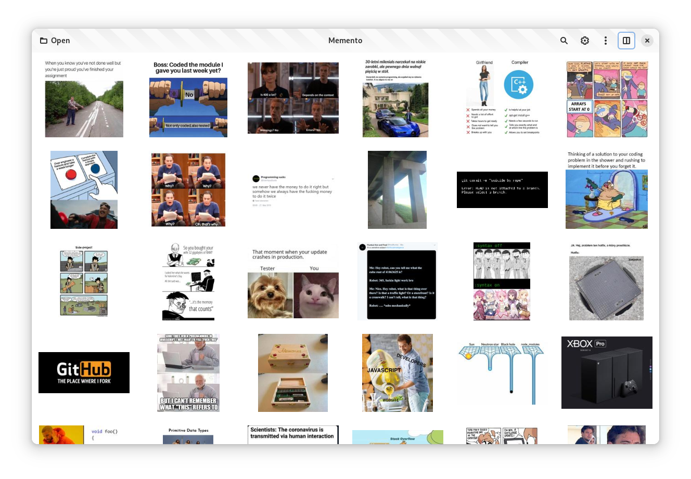
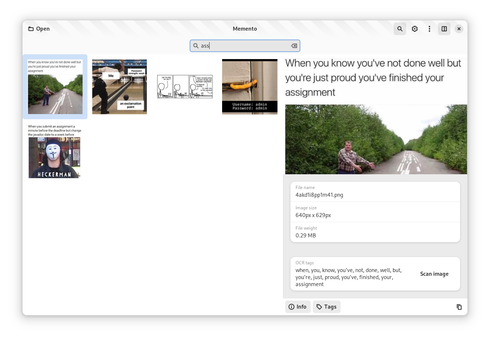

# Memeplex

Your memes, GIFs and reels, found by what is in them. A library app for GNOME, Android and
Windows that indexes your meme folders on the device (text in images, what they show) so you
can search them by description, then copy, drag or share the right one.

## Status

Being rewritten in Rust, with a shared core and native apps; the Linux app is an empty window
so far. See the [roadmap](docs/ROADMAP.md) for what is planned.

## Building

The Linux app needs Rust, GTK 4, libadwaita 1.8 or newer (GNOME 49), `blueprint-compiler` and
gettext:

```sh
cargo run -p memeplex-linux          # run from the checkout
make -C memeplex/linux install       # install into ~/.local
make -C memeplex/linux flatpak       # build and install the Flatpak
```

The first version, a GTK app in Python (formerly named Memento), is kept on the
[`python`](https://github.com/AperteDev/memeplex/tree/python) branch.

| List | Preview |
| --- | --- |
|  |  |
